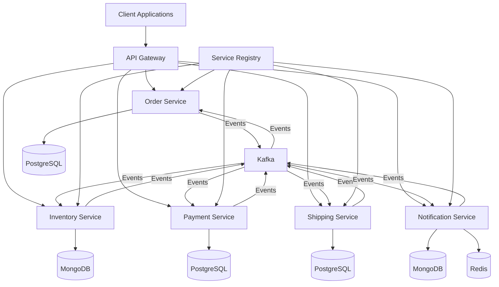

# E-commerce Microservices with Saga Pattern


A professional implementation of an e-commerce system using microservice architecture with Saga pattern for distributed transaction management.

*Created by: hacisimsek*  
*Last Updated: 2025-05-26 18:40:03*

## Table of Contents

- [Overview](#overview)
- [Architecture](#architecture)
- [Microservices](#microservices)
- [Technologies](#technologies)
- [Saga Pattern Implementation](#saga-pattern-implementation)
- [Project Structure](#project-structure)
- [Setup Instructions](#setup-instructions)
- [API Documentation](#api-documentation)
- [Testing](#testing)
- [Contributing](#contributing)

## Overview

This project implements a robust e-commerce system using a microservices architecture. The system handles order processing, inventory management, payment processing, shipping logistics, and customer notifications while maintaining data consistency across distributed services through the Saga pattern.

## Architecture

The architecture follows the microservices pattern with the following components:



## Microservices

1. **Order Service**:
    - Manages order creation and lifecycle
    - Initiates the order saga process
    - Tracks order status throughout the saga

2. **Inventory Service**:
    - Manages product inventory
    - Handles inventory reservation during order processing
    - Provides inventory availability checks

3. **Payment Service**:
    - Processes customer payments
    - Manages payment refunds for compensation transactions
    - Tracks payment status

4. **Shipping Service**:
    - Creates shipments for orders
    - Generates tracking information
    - Manages delivery status

5. **Notification Service**:
    - Sends notifications to customers
    - Supports multiple notification channels
    - Tracks notification delivery status

6. **Infrastructure Services**:
    - **Service Registry**: Service discovery with Eureka
    - **API Gateway**: Routing and cross-cutting concerns

## Technologies

- **Java 17**: Core programming language
- **Spring Boot 3.2.12**: Application framework
- **Spring Cloud**: Microservices toolkit
- **Apache Kafka**: Event streaming platform for service communication
- **Databases**:
    - **PostgreSQL**: For Order, Payment, and Shipping services
    - **MongoDB**: For Inventory and Notification services
    - **Redis**: For caching and temporary data storage
- **Docker & Docker Compose**: Containerization and orchestration
- **Maven**: Build and dependency management

## Saga Pattern Implementation

This project implements the Saga pattern using a choreography-based approach:

### Order Processing Flow:

1. **Order Creation**:
    - Customer places an order
    - Order service creates an order with PENDING status
    - Order service publishes OrderCreatedEvent

2. **Inventory Reservation**:
    - Inventory service consumes OrderCreatedEvent
    - Checks product availability
    - Reserves inventory if available
    - Publishes InventoryReservedEvent or InventoryReservationFailedEvent

3. **Payment Processing**:
    - Payment service consumes InventoryReservedEvent
    - Processes payment
    - Publishes PaymentProcessedEvent or PaymentFailedEvent

4. **Shipping Creation**:
    - Shipping service consumes PaymentProcessedEvent
    - Creates shipping record
    - Publishes ShipmentProcessedEvent or ShipmentFailedEvent

5. **Order Completion**:
    - Order service updates order status to COMPLETED

### Compensation Transactions:

If any step fails, the system executes compensation transactions to maintain consistency:

- **Inventory Failure**: Order is marked `CANCELLED`, customer is notified
- **Payment Failure**: Inventory service releases reserved inventory, order is marked `FAILED`
- **Shipping Failure**: Order is marked `FAILED` *(refund + inventory release is planned, see [docs/ROADMAP.md](docs/ROADMAP.md) Phase 2)*
- **Notification Service**: Informs the customer about transaction status (success/failure)

Events are published with the order ID as the Kafka key and a type header, so each listener
dispatches on the concrete event class (`@KafkaHandler`). Because events from different topics can
arrive out of order, the order service only accepts forward status transitions.

## Project Structure

```
ecommerce-microservices/
├── pom.xml                          # Parent POM
├── Dockerfile                       # Single multi-stage image build (--build-arg SERVICE=...)
├── docker-compose.yml               # Full local stack: infrastructure + all services
├── .env.example                     # Host ports and simulation knobs
├── common-library/                  # Shared events, Kafka topics and Kafka defaults
├── service-registry/                # Eureka Service Discovery
├── api-gateway/                     # Spring Cloud Gateway
├── order-service/                   # Order management, starts the saga
├── inventory-service/               # Inventory management and reservations
├── payment-service/                 # Payment processing (simulated provider)
├── notification-service/            # Notification handling
├── shipping-service/                # Shipping management
├── scripts/                         # Postgres init + end-to-end smoke test
└── docs/ROADMAP.md                  # Improvement plan
```

## Setup Instructions

### Prerequisites

- Docker with Docker Compose v2 (about 4 GB of memory available to Docker)
- Java 17+ only if you want to build or run services outside Docker (Maven comes via `./mvnw`)

### Run everything with Docker (recommended)

```bash
git clone https://github.com/hacisimsek/ecommerce-microservices.git
cd ecommerce-microservices
cp .env.example .env        # optional: change host ports
docker compose up -d --build
```

The first build takes a few minutes. Services register with Eureka within about a minute.

| What | URL |
|------|-----|
| API Gateway | http://localhost:8088 |
| Eureka dashboard | http://localhost:8761 |
| Kafka UI (`docker compose --profile tools up -d`) | http://localhost:8089 |

Host ports default to values that avoid other common local stacks (Postgres `5433`, Redis `6380`,
Kafka `29092`); change them in `.env`.

### Verify the saga end to end

```bash
./scripts/smoke-test.sh
```

It creates stock, places orders through the gateway and checks three flows: the happy path
(`SHIPPED`, stock reserved, payment, shipment and notifications created), an out-of-stock order
(`CANCELLED`) and a declined payment (`FAILED`, reservation released).

### Run a service from the IDE

Start the infrastructure only, then run any service with its defaults (they point at `localhost`):

```bash
docker compose up -d postgres mongodb redis kafka service-registry
./mvnw -pl order-service -am spring-boot:run
```

### Configuration

| Variable | Default | Used by |
|----------|---------|---------|
| `KAFKA_BOOTSTRAP_SERVERS` | `localhost:29092` | all business services |
| `EUREKA_URL` | `http://localhost:8761/eureka/` | all services |
| `POSTGRES_HOST` / `POSTGRES_PORT` | `localhost` / `5433` | order, payment, shipping |
| `MONGO_HOST` / `MONGO_PORT` | `localhost` / `27017` | inventory, notification |
| `REDIS_HOST` / `REDIS_PORT` | `localhost` / `6380` | notification |
| `PAYMENT_FAILURE_RATE` | `0.0` | payment: random decline probability |
| `PAYMENT_MAX_AMOUNT` | `10000` | payment: orders above this are declined |

## API Documentation

### Order Service

#### Create an Order
```
POST /api/orders
Content-Type: application/json

{
  "customerId": "3fa85f64-5717-4562-b3fc-2c963f66afa6",
  "items": [
    {
      "productId": "3fa85f64-5717-4562-b3fc-2c963f66afa6",
      "productName": "Smartphone",
      "quantity": 1,
      "price": 799.99
    }
  ]
}
```

#### Get Order by ID
```
GET /api/orders/{orderId}
```

#### Get All Customer Orders
```
GET /api/orders/customer/{customerId}
```

### Inventory Service

#### Create Inventory Item
```
POST /api/inventory
Content-Type: application/json

{
  "name": "Smartphone",
  "description": "Latest smartphone model",
  "quantity": 100
}
```

#### Check Product Availability
```
GET /api/inventory/check?productId={productId}&quantity={quantity}
```

### Payment Service

#### Get Payment by Order ID
```
GET /api/payments/order/{orderId}
```

### Shipping Service

#### Get Shipment by Order ID
```
GET /api/shipping/order/{orderId}
```

### Notification Service

#### Get Customer Notifications
```
GET /api/notifications/customer/{customerId}
```

## Testing

```bash
./mvnw verify               # unit tests
./scripts/smoke-test.sh     # end-to-end saga against the running stack
```

Integration tests with Testcontainers are planned in [docs/ROADMAP.md](docs/ROADMAP.md) (Phase 5).

## Contributing

1. Fork the repository
2. Create your feature branch (`git checkout -b feature/amazing-feature`)
3. Commit your changes (`git commit -m 'Add some amazing feature'`)
4. Push to the branch (`git push origin feature/amazing-feature`)
5. Create a new Pull Request

---

*© 2025 hacisimsek. All rights reserved.*
