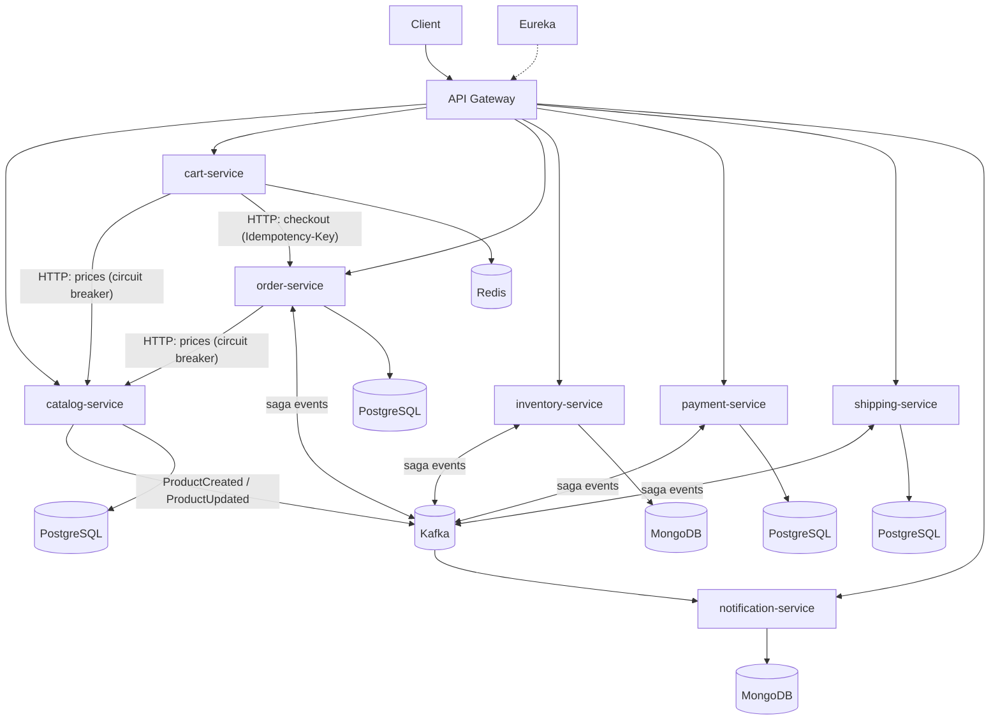

# E-commerce Microservices with Saga Pattern


A professional implementation of an e-commerce system using microservice architecture with Saga pattern for distributed transaction management.

*Created by: hacisimsek*

## Table of Contents

- [Overview](#overview)
- [Architecture](#architecture)
- [Microservices](#microservices)
- [Technologies](#technologies)
- [Saga Pattern Implementation](#saga-pattern-implementation)
- [Project Structure](#project-structure)
- [Setup Instructions](#setup-instructions)
- [API Documentation](#api-documentation)
- [Testing](#testing)
- [Contributing](#contributing)

## Overview

This project implements a robust e-commerce system using a microservices architecture. The system handles order processing, inventory management, payment processing, shipping logistics, and customer notifications while maintaining data consistency across distributed services through the Saga pattern.

## Architecture



Synchronous calls are used only where the caller needs an answer now (prices at checkout);
everything else flows through Kafka events via the transactional outbox.

## Microservices

| Service | Store | Responsibility |
|---------|-------|----------------|
| **catalog-service** | PostgreSQL | Categories, products, prices — the single source of truth for what is sold and for how much. Publishes `ProductCreated/Updated`. |
| **cart-service** | Redis | Per-customer carts with a 30-day TTL. Shows current catalog prices (falls back to the last known ones if the catalog is down). Checkout hands the cart to order-service. |
| **order-service** | PostgreSQL | Prices orders from the catalog, starts the saga, tracks order status. Supports `Idempotency-Key`. |
| **inventory-service** | MongoDB | One stock record per catalog product (created from catalog events); reserves, confirms and releases stock. |
| **payment-service** | PostgreSQL | Charges and refunds (simulated provider). |
| **shipping-service** | PostgreSQL | Creates shipments and tracking numbers (simulated carrier). |
| **notification-service** | MongoDB | Records customer notifications for each saga outcome. |
| **api-gateway** / **service-registry** | — | Spring Cloud Gateway routing; Eureka discovery. |

## Technologies

- **Java 21** (virtual threads enabled): Core programming language
- **Spring Boot 3.5**: Application framework
- **Spring Cloud 2025.0**: Gateway (WebFlux) and Eureka
- **Flyway**: Versioned database migrations (Hibernate only validates the schema)
- **Apache Kafka**: Event streaming platform for service communication
- **Databases**:
    - **PostgreSQL**: For Order, Payment, and Shipping services
    - **MongoDB**: For Inventory and Notification services
    - **Redis**: For caching and temporary data storage
- **Docker & Docker Compose**: Containerization and orchestration
- **Maven**: Build and dependency management

## Saga Pattern Implementation

This project implements the Saga pattern using a choreography-based approach:

### Order Processing Flow

| Step | Consumer | Reacts to | Publishes |
|------|----------|-----------|-----------|
| 1 | order-service (REST) | `POST /api/orders` | `OrderCreatedEvent` (order `INVENTORY_CHECKING`) |
| 2 | inventory-service | `OrderCreatedEvent` | `InventoryReservedEvent` or `InventoryReservationFailedEvent` |
| 3 | payment-service | `InventoryReservedEvent` | `PaymentProcessedEvent` or `PaymentFailedEvent` |
| 4 | shipping-service | `PaymentProcessedEvent` | `ShipmentProcessedEvent` or `ShipmentFailedEvent` |
| 5 | inventory-service | `ShipmentProcessedEvent` | — (reservation confirmed, stock leaves the warehouse) |

The order service follows along and moves the order to `INVENTORY_RESERVED` → `PAYMENT_COMPLETED` → `SHIPPED`.

### Compensation

| Failure | Order | Inventory | Payment | Customer |
|---------|-------|-----------|---------|----------|
| Out of stock | `CANCELLED` | nothing reserved | — | "order cancelled" |
| Payment declined | `FAILED` | reservation released | `FAILED` | "payment failed" |
| Shipping rejected | `FAILED` | reservation released | `REFUNDED` (`PaymentRefundedEvent`) | "payment refunded" |

For local testing the fake providers fail deterministically: payments above `PAYMENT_MAX_AMOUNT`
(10 000) are declined, shipments above `SHIPPING_MAX_INSURED_VALUE` (5 000) are rejected.

### Delivery guarantees

- **Transactional outbox.** Services never call Kafka inside a business transaction. The event
  is written to an `outbox` table (Postgres) or collection (MongoDB) in the same transaction as
  the state change; `OutboxRelay` sends it to Kafka and deletes it once the broker acknowledged.
  MongoDB runs as a single-node replica set because multi-document transactions need one.
- **Idempotent consumers.** Every handler first records `(eventId, consumer)` in
  `processed_events` in the same transaction, so a redelivered event changes nothing.
  Unique constraints (one payment / shipment per order) back this up.
- **Ordering.** Events are keyed by order ID, so one order's events stay in one partition. Events
  from different topics can still arrive out of order, so the order service only accepts forward
  status transitions, and `@Version` columns turn concurrent updates into retries.
- **Dead letter topics.** A failing record is retried with exponential backoff (0.5 s → 4 s, 4
  retries) and then published to `<topic>.DLT` with the exception in its headers. Records that can
  never succeed (undeserializable payloads) go there immediately. Browse them with Kafka UI.

### API errors

Every service answers errors as [RFC 9457](https://www.rfc-editor.org/rfc/rfc9457)
`application/problem+json`: `404` for unknown resources, `400` with an `errors` list for
validation failures, `409` for business rule conflicts, and a generic `500` that never leaks internals.

```json
{
  "type": "https://api.ecommerce.local/problems/validation",
  "title": "Validation failed",
  "status": 400,
  "detail": "Request has 2 invalid field(s)",
  "errors": [{ "field": "customerId", "message": "must not be null" }]
}
```

## Project Structure

```
ecommerce-microservices/
├── pom.xml                          # Parent POM
├── Dockerfile                       # Single multi-stage image build (--build-arg SERVICE=...)
├── docker-compose.yml               # Full local stack: infrastructure + all services
├── .env.example                     # Host ports and simulation knobs
├── common-library/                  # Shared events, outbox, idempotency, DLT and error handling
├── service-registry/                # Eureka Service Discovery
├── api-gateway/                     # Spring Cloud Gateway
├── catalog-service/                 # Categories, products and prices
├── cart-service/                    # Redis carts and checkout
├── order-service/                   # Order management, starts the saga
├── inventory-service/               # Inventory management and reservations
├── payment-service/                 # Payment processing (simulated provider)
├── notification-service/            # Notification handling
├── shipping-service/                # Shipping management
├── scripts/                         # Postgres init + end-to-end smoke test
└── docs/ROADMAP.md                  # Improvement plan
```

## Setup Instructions

### Prerequisites

- Docker with Docker Compose v2 (about 4 GB of memory available to Docker)
- Java 21+ only if you want to build or run services outside Docker (Maven comes via `./mvnw`)

### Run everything with Docker (recommended)

```bash
git clone https://github.com/hacisimsek/ecommerce-microservices.git
cd ecommerce-microservices
cp .env.example .env        # required: credentials and host ports
docker compose up -d --build
./scripts/seed-demo-stock.sh   # once the services are up: stock for the demo catalog
```

The first build takes a few minutes. Services register with Eureka within about a minute.

| What | URL |
|------|-----|
| API Gateway | http://localhost:8088 |
| Eureka dashboard | http://localhost:8761 |
| Kafka UI (`docker compose --profile tools up -d`) | http://localhost:8089 |

Compose refuses to start without the credentials from `.env`. The values in `.env.example`
are for local development only.

> **Upgrading from an earlier checkout?** Schemas are owned by Flyway, every store requires
> credentials and MongoDB now runs as a replica set, so recreate the volumes once: `docker compose down -v`.

Host ports default to values that avoid other common local stacks (Postgres `5433`, Redis `6380`,
Kafka `29092`); change them in `.env`.

### Verify the saga end to end

```bash
./scripts/smoke-test.sh
```

It creates catalog products and stock, shops through cart and checkout, and checks the happy path,
server-side pricing, checkout idempotency, cart price refresh, each compensation branch (out of stock, payment declined, shipping rejected), the problem-detail error
format, that a replayed Kafka event is ignored, and that a poison message lands on the DLT.

### Run a service from the IDE

Start the infrastructure only, then run any service with its defaults (they point at `localhost`):

```bash
docker compose up -d postgres mongodb redis kafka service-registry
set -a; source .env; set +a
DB_USERNAME=order_svc DB_PASSWORD=$ORDER_DB_PASSWORD ./mvnw -pl order-service -am spring-boot:run
```

### Configuration

Shared defaults (Kafka serialization, Eureka, actuator, JPA, virtual threads) live in
`common-library/src/main/resources/shared-defaults.yml` and are loaded with the lowest
precedence, so a service's `application.yml` or an environment variable always wins.

| Variable | Default | Used by |
|----------|---------|---------|
| `KAFKA_BOOTSTRAP_SERVERS` | `localhost:29092` | all business services |
| `EUREKA_URL` | `http://localhost:8761/eureka/` | all services |
| `POSTGRES_HOST` / `POSTGRES_PORT` | `localhost` / `5433` | catalog, order, payment, shipping |
| `DB_USERNAME` / `DB_PASSWORD` | *(required)* | catalog, order, payment, shipping: each has its own role (`catalog_svc`, `order_svc`, ...) owning only its database |
| `MONGO_HOST` / `MONGO_PORT` | `localhost` / `27017` | inventory, notification |
| `MONGO_USERNAME` / `MONGO_PASSWORD` | *(required)* | inventory, notification |
| `REDIS_HOST` / `REDIS_PORT` / `REDIS_PASSWORD` | `localhost` / `6380` / *(required)* | cart, notification |
| `PAYMENT_FAILURE_RATE` | `0.0` | payment: random decline probability |
| `PAYMENT_MAX_AMOUNT` | `10000` | payment: orders above this are declined |
| `SHIPPING_MAX_INSURED_VALUE` | `5000` | shipping: orders above this cannot be shipped |

### Database migrations

Schema changes go in `<service>/src/main/resources/db/migration` as `V<n>__<description>.sql`.
Flyway applies them on startup; `ddl-auto: validate` makes the service fail fast if an entity
and the schema disagree.

## API Documentation

### Catalog

```
GET  /api/catalog/categories
POST /api/catalog/categories                 {"name", "slug", "description"}
GET  /api/catalog/products?q=&categoryId=&page=0&size=20&sort=price,asc
GET  /api/catalog/products/{id}
GET  /api/catalog/products/lookup?ids=a,b    batch lookup used by other services
POST /api/catalog/products                   {"sku", "name", "description", "price", "imageUrl", "categoryId"}
PUT  /api/catalog/products/{id}              same body, plus "active": false to stop selling
```

A demo catalog (4 categories, 12 products) is created on first start. New products start with zero
stock; give the demo catalog some with `./scripts/seed-demo-stock.sh` (default 25 each).

### Cart and checkout

```
GET    /api/carts/{customerId}
POST   /api/carts/{customerId}/items               {"productId", "quantity"}
PUT    /api/carts/{customerId}/items/{productId}   {"quantity"}   (0 removes the line)
DELETE /api/carts/{customerId}/items/{productId}
DELETE /api/carts/{customerId}
POST   /api/carts/{customerId}/checkout            -> 201 {"orderId", "status", "totalAmount"}
```

Checkout sends the cart's revision as `Idempotency-Key`, so a retried checkout returns the same
order. The cart is emptied only once the order exists. Until authentication lands, the customer id
is part of the URL; it will come from the access token instead.

### Order Service

#### Create an Order
```
POST /api/orders
Content-Type: application/json
Idempotency-Key: 6c1f...        (optional; a repeat returns the original order with 200)

{
  "customerId": "3fa85f64-5717-4562-b3fc-2c963f66afa6",
  "items": [
    { "productId": "3fa85f64-5717-4562-b3fc-2c963f66afa6", "quantity": 1 }
  ]
}
```

Names and prices are taken from the catalog; any price a client sends is ignored. Unknown or
inactive products are rejected with `409`; if the catalog is unreachable the answer is a
retryable `503`.

#### Get Order by ID
```
GET /api/orders/{orderId}
```

#### Get All Customer Orders
```
GET /api/orders/customer/{customerId}
```

### Inventory Service

```
GET /api/inventory
GET /api/inventory/{productId}
PUT /api/inventory/{productId}/stock      {"availableQuantity": 25}
GET /api/inventory/check?productId={productId}&quantity={quantity}
```

### Payment Service

#### Get Payment by Order ID
```
GET /api/payments/order/{orderId}
```

### Shipping Service

#### Get Shipment by Order ID
```
GET /api/shipping/order/{orderId}
```

### Notification Service

#### Get Customer Notifications
```
GET /api/notifications/customer/{customerId}
```

## Testing

```bash
./mvnw verify               # unit tests + enforcer + formatting check
./mvnw spotless:apply       # fix import order / whitespace
./scripts/smoke-test.sh     # end-to-end saga against the running stack
```

Integration tests with Testcontainers are planned in [docs/ROADMAP.md](docs/ROADMAP.md) (Phase 5).

## Contributing

1. Fork the repository
2. Create your feature branch (`git checkout -b feature/amazing-feature`)
3. Commit your changes (`git commit -m 'Add some amazing feature'`)
4. Push to the branch (`git push origin feature/amazing-feature`)
5. Create a new Pull Request

---

*© 2025 hacisimsek. All rights reserved.*
