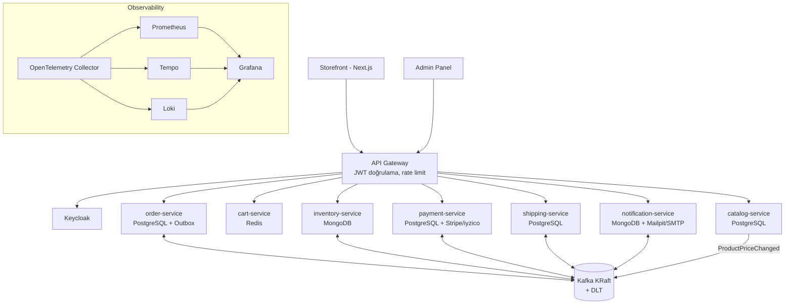

# E-Commerce Microservices — İyileştirme ve Upgrade Yol Haritası

> Hazırlanma tarihi: 2026-10-17 · Başlangıç noktası: `main` @ `2f91b13`

Amaç: Projeyi **(1) uçtan uca çalışan**, **(2) gerçek bir e-ticaret altyapısının temel akışlarını kapsayan**, **(3) profesyonel standartlarda** (test, gözlemlenebilirlik, güvenlik, CI/CD) bir sisteme dönüştürmek. Sonraki teknik derinleştirmeler (CQRS, orkestrasyon saga, Avro, k8s) bu temelin üzerine eklenecek.

---

## 1. Mevcut Durum Tespiti

Kod gözden geçirildi ve `mvn package` denendi. Bulgular, önem sırasına göre:

### 🔴 Kritik — sistem şu an çalışmıyor

| # | Sorun | Nerede | Etki |
|---|-------|--------|------|
| K1 | **Build kırık.** `common-library` bir Spring Boot uygulaması gibi paketleniyor (`spring-boot-maven-plugin` + `CommonApplication` main sınıfı). Fat-jar'da sınıflar `BOOT-INF/classes` altında kaldığı için diğer servisler `com.hacisimsek.common.*` paketlerini göremiyor. | `common-library/pom.xml`, root `pom.xml` (plugin tüm modüllere miras kalıyor) | `order-service` derlenmiyor → hiçbir servis ayağa kalkmıyor |
| K2 | **Maven wrapper eksik.** `.mvn/wrapper/maven-wrapper.properties` repoda yok, `./mvnw` çalışmıyor. | root | Yeni geliştirici/CI build alamaz |
| K3 | **docker-compose yok.** README "Docker Compose" diyor ama ne `docker-compose.yml` ne `Dockerfile` var. Config'ler `postgres`, `kafka`, `mongodb`, `service-registry` host adlarına bağlı. | root | Lokal ortam kurulamıyor |
| K4 | **Saga event'leri hiç eşleşmeyecek.** Listener'lar `Object` alıyor ve `JsonDeserializer<>(Object.class)` kullanılıyor; tip bilgisi olmadan JSON `LinkedHashMap`'e çözülür, `instanceof InventoryReservedEvent` asla true olmaz. Ayrıca sadece 3 serviste `KafkaConfig` var, shipping/notification varsayılan (String) deserializer ile çalışır. | Tüm `*SagaHandler`, `KafkaConfig` | Saga akışı ilk adımda durur |

### 🟠 Doğruluk ve iş mantığı hataları

- **Ödeme tutarı sabit:** `PaymentServiceImpl` tutarı `100`, `customerId`'yi `UUID.randomUUID()` alıyor; ödeme `Random` ile başarısız oluyor. Event'ler tutar/müşteri taşımıyor.
- **Fiyat istemciden geliyor:** `OrderRequest` içindeki `price` ve `productName` client tarafından gönderiliyor → kullanıcı kendi fiyatını belirleyebilir. Fiyat katalogdan okunmalı.
- **Dual-write problemi:** DB'ye kayıt + `kafkaTemplate.send` aynı transaction'da değil. Kafka gönderimi başarısız olursa sipariş `INVENTORY_CHECKING`'de sonsuza kadar asılı kalır (veya tersi).
- **Idempotency yok:** Kafka at-least-once teslim eder; aynı event iki kez gelirse stok iki kez rezerve edilir, ödeme iki kez alınır.
- **Eksik kompanzasyon:** Shipping başarısız olduğunda ödeme iadesi ve stok serbest bırakma tetiklenmiyor (README'de var, kodda yok). Başarılı akışta rezervasyon "commit" edilmiyor.
- **Hata yönetimi yok:** `DefaultErrorHandler`, retry, Dead Letter Topic yok; listener exception'ı = sonsuz retry veya mesaj kaybı.
- **`BaseEvent`** içinde `createdAt = "2025-05-24T13:39:46"` ve `createdBy = "simsekhaciI"` sabit kodlanmış. `LocalDateTime` yerine `Instant` olmalı.
- **REST hataları:** `RuntimeException("not found")` → 500 döner. `@ControllerAdvice` / RFC 7807 `ProblemDetail` yok; `@Valid` sadece order-service'te.
- Kafka key gönderilmiyor (`send(topic, event)`) → aynı siparişin event'leri farklı partition'lara düşüp sırasız işlenebilir.

### 🟡 Altyapı ve kod kalitesi

- Spring Boot **3.2.12 ve Spring Cloud 2023.0 destek dışı (EOL)**. Makinede Java 21 var, proje 17 hedefliyor.
- Her serviste hem `application.yml` hem `application.properties` var; her alt modülde ayrı `mvnw`/`.gitignore` kopyaları (Spring Initializr artığı).
- `ddl-auto: update`, `show-sql: true`, şifreler config'te düz metin; Flyway/Liquibase yok; profil (`local`/`docker`/`prod`) ayrımı yok.
- Testler sadece `contextLoads`; `inventory-service` test paketi (`inventoryservice`) ana paketle (`inventory`) uyuşmuyor → test bile context bulamaz.
- Gözlemlenebilirlik yok (tracing, metrik, merkezi log). Correlation ID üretiliyor ama loglara/trace'e taşınmıyor.
- Güvenlik yok: kimlik doğrulama, yetkilendirme, rate limiting, CORS.
- CI/CD yok. `HELP.md`, `project-structure.txt` gibi artık dosyalar repoda.

### 🔵 E-ticaret olarak eksik domain

Şu anki sistem sadece "sipariş sonrası" akışı modelliyor. Gerçek bir e-ticaret altyapısı için eksik olanlar:

- **Ürün kataloğu** (ürün, kategori, fiyat, görsel, arama)
- **Sepet** (misafir + kullanıcı sepeti, sepet → sipariş)
- **Müşteri / kimlik** (kayıt, giriş, adres defteri, roller: müşteri/admin)
- **Gerçek ödeme entegrasyonu** (Stripe veya iyzico sandbox, webhook)
- **Kullanıcı arayüzü** (vitrin + admin paneli)

---

## 2. Hedef Mimari



**Sipariş akışı (hedef):** Sepet → Checkout (fiyat katalogdan doğrulanır) → `OrderCreated` (outbox) → Stok rezervasyonu → Ödeme (gerçek tutar) → Kargo → `OrderCompleted` → Bildirim. Her başarısızlıkta tam kompanzasyon zinciri.

**Teknoloji hedefleri:** Java 21 · Spring Boot 3.5.x · Spring Cloud 2025.0.x · Kafka (KRaft, Zookeeper'sız) · Testcontainers · Flyway · Keycloak · Micrometer + OpenTelemetry.

> Not: Eureka lokal/compose için kalabilir; Kubernetes'e geçişte k8s service discovery ile değiştirilmesi Faz 6'da değerlendirilecek.

---

## 3. Fazlar

Her faz kendi başına **çalışan, demo edilebilir** bir sistem bırakır. Her faz ayrı branch/PR olarak ilerler.

### Faz 0 — "Çalışır Hale Getir" ✅ tamamlandı

Hedef: `docker compose up` → bir sipariş oluştur → saga'nın mutlu yolu uçtan uca geçsin.

- [x] `common-library`'yi düz kütüphane yap: `CommonApplication`'ı ve boot plugin'ini kaldır; root pom'da plugin'i `pluginManagement`'a taşı, sadece çalıştırılabilir servislerde aktif et.
- [x] Maven wrapper'ı tek kopya olarak root'ta düzelt; alt modüllerdeki `mvnw`, `.gitignore`, `HELP.md` kopyalarını sil.
- [x] Ortak Kafka yapılandırması: `common-library` içinde tek bir `KafkaConfig` (JsonSerializer type header'ları + `spring.json.type.mapping` ile event tipleri), listener'ları `@KafkaHandler` ile tipli metotlara böl.
- [x] Event'leri genişlet: `OrderCreatedEvent` → `InventoryReservedEvent` → ödeme için `amount` + `customerId` taşınsın; ödemedeki sabit değerleri kaldır.
- [x] `docker-compose.yml`: PostgreSQL (çoklu DB script'i mevcut), MongoDB, Redis, Kafka (KRaft), Kafka UI, tüm servisler. Her servis için çok aşamalı `Dockerfile` (veya Jib / `spring-boot:build-image`).
- [x] Profil ayrımı: `application.yml` (local, `localhost`) + `application-docker.yml`; `.properties` dosyalarını sil.
- [x] `BaseEvent` sabit değerlerini kaldır, `Instant` kullan.
- [x] Inventory test paketini düzelt; `mvn verify` yeşil.
- [x] README'de "5 dakikada çalıştır" bölümü + uçtan uca `scripts/smoke-test.sh`.

Faz 0'da ek olarak: event'ler artık Kafka key'i (`orderId`) ile gönderiliyor, `OrderCreatedEvent` transaction commit'inden sonra yayınlanıyor, sipariş durumu sadece ileri gidebiliyor (sırasız event'lere karşı), consumer'larda basit idempotency kontrolü ve sınırlı retry'lı hata yöneticisi var. Profil dosyaları yerine env değişkenli tek `application.yml` tercih edildi.

**Kabul kriteri:** Temiz klon → `docker compose up -d --build` → ürün stoğu ekle → sipariş oluştur → sipariş `SHIPPED`/`COMPLETED` olur, bildirim kaydı oluşur.

### Faz 1 — Platform Upgrade ✅ tamamlandı

- [x] Java 21, Spring Boot 3.5.16, Spring Cloud 2025.0.3; `spring.threads.virtual.enabled=true`.
- [x] Versiyonlar Boot BOM'dan; Boot'un yönettiği sürümleri ezen `spring-kafka.version` / `lombok.version` override'ları kaldırıldı. Lombok için açık `annotationProcessorPaths`.
- [x] Flyway ile şema yönetimi (order, payment, shipping `V1`); `ddl-auto: validate`. `payments.order_id` ve `shipments.order_id` unique (idempotency'yi DB seviyesinde de garanti eder).
- [x] Sırlar env değişkenlerinden; uygulama config'inde varsayılan şifre yok, compose `.env` olmadan başlamıyor. Her servis için ayrı Postgres rolü (`order_svc` yalnızca `order_db`'ye bağlanabilir); MongoDB ve Redis kimlik doğrulamalı.
- [x] Ortak ayarlar `shared-defaults.yml` ile en düşük öncelikte yükleniyor (servisler istediğini ezebilir).
- [x] Spotless (import sırası, kullanılmayan import, whitespace) + `maven-enforcer` (Java 21+, Maven 3.9+, plugin sürümleri).
- [x] Gateway `spring-cloud-starter-gateway-server-webflux` ve yeni `spring.cloud.gateway.server.webflux.*` property'lerine taşındı.

> Not: Spring Boot 4.x yayında. 3.5 → 4.0 geçişi (Jakarta EE 11, Jackson 3, modüler starter'lar) ayrı bir iş olarak Faz 7'ye eklendi.

### Faz 2 — Güvenilirlik ve Doğruluk ✅ tamamlandı

- [x] **Transactional Outbox** (order, payment, shipping: Postgres tablosu; inventory: Mongo koleksiyonu + replica set transaction). `OutboxRelay` broker onayından sonra siler; batch sırasını korur, `FOR UPDATE SKIP LOCKED` ile çoklu instance'a hazır. (İleri adım: Debezium CDC — Faz 7.)
- [x] **Idempotent consumer:** `processed_events(event_id, consumer)` iş değişikliğiyle aynı transaction'da; ayrıca `payments.order_id` / `shipments.order_id` unique.
- [x] Kafka mesaj key'i = `orderId`.
- [x] `DefaultErrorHandler` + exponential backoff (0.5s→4s, 4 deneme) + **Dead Letter Topic** (`<topic>.DLT`, aynı partition, hata bilgisi header'larda); deserialize edilemeyen kayıtlar direkt DLT'ye.
- [x] Eksiksiz kompanzasyon: shipping reddi → ödeme iadesi (`PaymentRefundedEvent`) + stok serbest + müşteri bildirimi; başarılı akışta rezervasyon `CONFIRMED` ve stok düşülüyor.
- [x] Sipariş durumu yalnızca ileri gider; optimistic locking (`@Version`: `orders`, `InventoryItem`, `InventoryReservation`).
- [x] Global `@RestControllerAdvice` + RFC 9457 `ProblemDetail`; `ResourceNotFoundException` (404), `BusinessRuleException` (409), alan bazlı validasyon hataları (400); 500'de iç detay sızmıyor.
- [x] Smoke test: tüm kompanzasyon dalları, hata formatı, event replay'in etkisiz olduğu ve poison mesajın DLT'ye düştüğü doğrulanıyor.

Bilinçli olarak ertelenenler (gerekçeli):

- **Kullanıcının sipariş iptali** ve **saga timeout**: choreography'de iptal, ödeme/kargo adımlarıyla yarışır (ör. iptalden sonra gelen `InventoryReservedEvent` ödemeyi tetikler). Doğru çözüm iptali her adımın tanıdığı bir event yapmak veya orkestrasyona geçmek; Faz 3 checkout ile birlikte ele alınacak, orkestrasyon karşılaştırması Faz 7'de.
- **DLT yeniden oynatma endpoint'i**: şimdilik Kafka UI ile inceleme; admin paneli ile birlikte Faz 4'te.
- **Resilience4j**: servisler arasında henüz senkron çağrı yok; checkout'ta katalog fiyat sorgusu geldiğinde (Faz 3) eklenecek.

### Faz 3 — E-ticaret Domain'ini Tamamla (devam ediyor)

**3a — Katalog, sepet, checkout ✅**

- [x] **catalog-service** (Postgres): kategori, ürün (SKU, fiyat, görsel, aktif/pasif), arama + kategori filtresi + sayfalama/sıralama, toplu `lookup` endpoint'i. `ProductCreated/Updated` event'leri outbox ile; demo katalog (4 kategori, 12 ürün) Flyway seed'i, event'leriyle birlikte.
- [x] **Inventory katalogla bağlı:** her ürün için stok kaydı `ProductCreatedEvent`'ten (id = productId) oluşur; stok `PUT /api/inventory/{id}/stock` ile ayarlanır. Serbest `POST /api/inventory` kaldırıldı.
- [x] **cart-service (Redis):** müşteri başına sepet, 30 gün TTL, satır başına adet limiti; her okumada güncel katalog fiyatı, katalog yoksa son bilinen fiyat + `pricesStale`; pasif ürün eklenemez.
- [x] **Checkout:** sepet → order-service; fiyat ve ürün adı **yalnızca katalogdan** (istemcinin gönderdiği fiyat yok sayılır); `Idempotency-Key` (sepet revizyonu) ile tekrar denenen checkout aynı siparişi döner; sipariş oluşmadan sepet silinmez. Katalog çağrısı DB transaction'ı dışında.
- [x] **Resilience4j** (Spring Cloud CircuitBreaker): katalog ve sipariş çağrılarında circuit breaker + time limiter; erişilemeyen bağımlılık → `503` + `retryable: true` ProblemDetail.
- [x] Modüllerdeki eski `<java.version>17` override'ları kaldırıldı (artık gerçekten Java 21 hedefleniyor).

**3b — Sırada**

- [ ] **Kimlik (Keycloak):** realm export'u compose'a dahil; gateway'de JWT doğrulama; `ROLE_CUSTOMER` / `ROLE_ADMIN`; müşteri id'si URL yerine token'dan; katalog yazma işlemleri yalnızca admin; misafir sepeti → giriş sonrası birleştirme.
- [ ] **Checkout ayrıntıları:** teslimat adresi, kargo seçeneği, insan okunur sipariş numarası (`ORD-2026-000123`); kullanıcı iptali + saga timeout (Faz 2'den ertelenen).
- [ ] **Ödeme:** `PaymentProvider` arayüzü + deterministik `FakeProvider` + Stripe test mode veya iyzico sandbox; webhook ile asenkron onay; iade.
- [ ] **Bildirim:** şablonlu e-posta (Thymeleaf) + lokal SMTP için Mailpit.
- [ ] Demo kullanıcılar (Keycloak ile).

### Faz 4 — Arayüz (~1 hafta)

- [ ] **Storefront (Next.js + TypeScript):** ürün listeleme/arama, ürün detay, sepet, checkout, sipariş geçmişi ve canlı durum takibi.
- [ ] **Admin paneli:** ürün/stok yönetimi, sipariş listesi, saga durumu, DLT mesajları.
- [ ] OpenAPI (springdoc) → gateway'de birleşik Swagger UI; frontend için tipli client üretimi.

### Faz 5 — Gözlemlenebilirlik ve Test (~4–5 gün)

- [ ] Micrometer Tracing + OpenTelemetry → Tempo; Kafka header'larıyla trace propagation (bir siparişin tüm servislerdeki yolculuğu tek trace'te).
- [ ] Prometheus + Grafana dashboard'ları (iş metrikleri: sipariş/dk, ödeme başarı oranı, saga süresi, DLT sayısı).
- [ ] JSON structured logging + Loki; loglarda `traceId` ve `orderId`.
- [ ] Test piramidi: birim testler (servis/durum makinesi), **Testcontainers** ile entegrasyon (Postgres, Mongo, Kafka), Spring Cloud Contract veya Pact ile event sözleşme testleri, uçtan uca saga testi (mutlu yol + her kompanzasyon senaryosu), k6 ile yük testi.
- [ ] JaCoCo kapsam raporu; hedef ≥ %70 kritik modüllerde.

### Faz 6 — CI/CD ve Dağıtım (~3–4 gün)

- [ ] GitHub Actions: build + test + Testcontainers, kod kalitesi, imaj build + GHCR push, Dependabot, CodeQL / Trivy taraması.
- [ ] Kubernetes manifest'leri veya Helm chart; lokal için kind/k3d; readiness/liveness probe'ları (Actuator).
- [ ] Gateway: rate limiting (Redis), CORS, güvenlik başlıkları.
- [ ] ADR'ler (`docs/adr/`): choreography vs orchestration, outbox, Keycloak seçimi vb.

### Faz 7 — İleri Teknik Konular (sonraki iyileştirme turu)

- Spring Boot 4.x / Spring Cloud 2025.1 geçişi
- Orkestrasyon tabanlı saga (order-service'te state machine / Temporal) ve choreography ile karşılaştırma
- Avro/Protobuf + Schema Registry, event versiyonlama
- CQRS: sipariş okuma modeli, Elasticsearch/OpenSearch ile ürün arama
- Debezium CDC ile outbox
- Multi-tenancy, i18n/çoklu para birimi, kupon/kampanya servisi
- Chaos testleri (Toxiproxy), canary deploy

---

## 4. Önerilen Çalışma Sırası

```
Faz 0 ──► Faz 1 ──► Faz 2 ──► Faz 3 ──► Faz 4
                       │                  ▲
                       └──► Faz 5 ────────┘   (test & gözlemlenebilirlik Faz 2'den itibaren paralel)
                                   Faz 6 (Faz 3 sonrası)
```

Faz 0 ve 1 birlikte tek PR olabilir; diğerleri özellik bazlı küçük PR'lar halinde ilerlemeli.

## 5. "Profesyonel Standart" Tanımı (Definition of Done)

Her PR için:

- `mvn verify` yeşil, yeni davranış testlerle kapsanmış
- `docker compose up` ile sistem ayağa kalkıyor
- API değişikliği OpenAPI'de, event değişikliği sözleşme testinde yansımış
- Loglarda `traceId`/`orderId` var, hata yolları `ProblemDetail` döndürüyor
- README / ADR güncel
